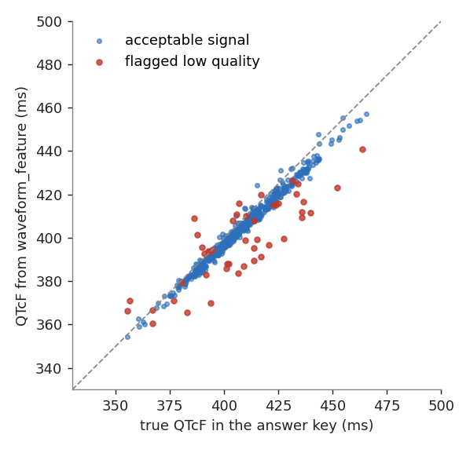

# **Synthetic Dataset Description**

The tutorial runs on a synthetic study dataset published in this repository: [`syntheticData/qtc/`](https://github.com/OHDSI/WaveformWG/tree/main/syntheticData/qtc). It contains **real WFDB files**, the OMOP tables they link to, the Waveform Extension tables built from them, and an answer key.

<br>

## **Privacy statement**

All persons, encounters, drugs, lab values and ECG signals are synthetic. No real individual, device or institution appears anywhere. The two drugs are generic placeholders ("antiemetic A" and "antiemetic B") with no real pharmacology.

<br>

## **What is in the repository**

```
syntheticData/qtc/
├── build.sh                     # rebuild everything (deterministic, fixed seed)
├── requirements.txt
├── src/
│   ├── simulate.py              # step 1: cohort, EHR facts, WFDB recordings, answer key
│   ├── etl_waveform.py          # step 2: WFDB + manifest -> waveform_occurrence / registry / channel_metadata
│   ├── extract_features.py      # step 3: intervals -> MEASUREMENT + waveform_feature
│   ├── qtcdetect.py             # the (toy) interval detector
│   ├── ecgsim.py                # beat-by-beat ECG simulator with known interval truth
│   └── summarize.py             # figures for this website
├── tutorial/
│   ├── sql/ex4_analytic_dataset.sql
│   └── solutions/ex1..ex4 (Python), ex4 (R)
└── data/
    ├── wfdb/                    # 542 records, A0000001.hea / .dat ...
    ├── source/ecg_manifest.csv  # what the ECG export system knows (accession, MRN, encounter, time)
    ├── omop/                    # person, visit_occurrence, drug_exposure, condition_occurrence, measurement, ...
    ├── waveform_extension/      # the four extension tables
    ├── derived/                 # analytic dataset and effect estimates written by Exercise 4
    └── answer_key/              # the truth: do not open before you try Exercise 3 and 4
```

<br>

## **The population**

| | |
|---|---|
| Persons | 300 synthetic adult inpatients, one visit each |
| New users of drug A or B | 262 (the rest receive neither and should fall out of your cohort) |
| ECG recordings | 542: a baseline ECG for everyone, and a follow-up ECG 20-40 hours after the first dose for 242 of the 262 users |
| Conditions | heart failure, essential hypertension, type 2 diabetes |
| Labs | serum potassium on the morning of admission |
| ECG format | WFDB format 16, 250 Hz, 10 s, leads I, II and III, 1000 ADU/mV, with the acquisition date and time in the header |

<br>

## **The Waveform Extension tables**

| Table | Rows | One row is |
|---|---|---|
| `waveform_occurrence` | 542 | one ECG session, linked to person and visit; follow-ups point to the preceding ECG |
| `waveform_registry` | 1,084 | one file: each ECG has a `.hea` and a `.dat` file |
| `waveform_channel_metadata` | 3,252 | one metadata value (sampling rate or resolution) of one lead of one `.dat` file |
| `waveform_feature` | 3,794 | one derived value (heart rate, RR, QT, QTcB, QTcF, QRS, noise level) of lead II of one ECG, with the algorithm used |

Each `waveform_feature` row also has a matching row in `MEASUREMENT` (linked by `measurement_id`), which is the row you analyze. Records with a high noise level carry the concept *Low signal quality* in `value_as_concept_id`, so a quality filter is a one-line join.

### Concepts

The ids 2082499xxx come from the existing WAVEFORM vocabulary delta (Diagnostic ECG, WFDB, HEA, DAT, leads I, II and III, SAMPLERATE, RESOLUTION, sps, Low signal quality). The ids 2082599xxx are **tutorial placeholders** for what the vocabulary does not yet define: the derived measurements, the algorithms, a few units, the derived-from-waveform type, and the two drugs. The full list is in [`concept.csv`](https://github.com/OHDSI/WaveformWG/blob/main/syntheticData/qtc/data/omop/concept.csv). Defining the real concepts is open work for the group.

<br>

## **How the data were generated**

Knowing the data-generating process is what lets you grade your own analysis.

- **Baseline QTcF** (Fridericia-corrected QT, in ms) = 400 + 8 if female + 0.5 per year of age above 60 + 10 if heart failure + 3 if type 2 diabetes - 14 per mmol/L of potassium above 4.0 + a person-specific random term (SD 12).
- **Treatment** is not random. The chance of receiving A rises with age, female sex and *low potassium*, and falls with heart failure. Age and potassium also raise QTc, so a naive comparison is **confounded**.
- **True effect of A on follow-up QTcF**: +14 ms in women, +6 ms in men. The comparator has no effect. The cohort average is about +10 ms.
- **Heart rate, QRS duration**: depend on age and heart failure but are *not* affected by the drug. They are the negative control outcomes in Exercise 4.
- **ECG waveform**: every beat is built from a P wave, QRS complex and T wave whose QRS onset and T-wave end are known exactly, with QT following the preceding RR interval. Beat-to-beat variability, baseline wander and powerline noise are added. About 7% of recordings get heavy noise to mimic poor contact.
- **Missingness**: about 8% of drug users have no follow-up ECG.

### The answer key

`data/answer_key/` holds the truth:

- `records_truth.csv` - per recording: true heart rate, RR, QT, QTcF, QTcB and QRS, and whether noise was added.
- `persons_truth.csv` - per person: all covariates, the true propensity score, and both potential outcomes (the QTcF if given A, and if given B or nothing).
- `effects.json` - the true average treatment effect (ATE) and effect in the treated (ATT), overall and by sex.



<br>

## **Rebuilding the dataset**

```sh
cd syntheticData/qtc
pip install -r requirements.txt
./build.sh
```

The build is deterministic. The random seed (`20261113`) and every simulation parameter are in `src/simulate.py`, so you can change the effect size, the amount of confounding or the noise rate and re-run the tutorial to see what changes.

<br>
