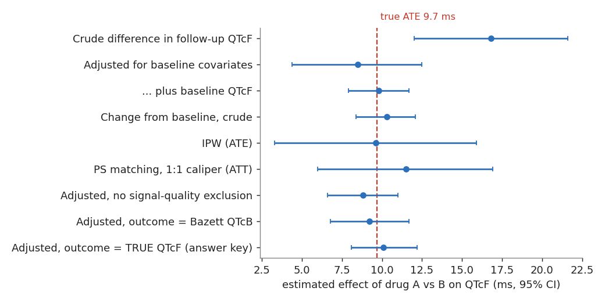

# **Exercise 4: Effect estimation**

## **Goal**

Estimate the effect of antiemetic A versus antiemetic B on QTc using features derived from ECG waveforms, compare crude and adjusted estimates, test them with negative controls, see what measurement choices do to the answer, and check everything against the answer key.

## **Background**

The target is a causal contrast in an observational dataset. Patients were not randomized: who received A depended on age, sex, heart failure and potassium, and age and potassium also move the QTc. A naive comparison is therefore confounded. The waveform features (Exercise 3) supply the outcome *and* a powerful covariate: the patient's own baseline QTc from the ECG taken before the first dose.

The design is an **active-comparator new-user cohort**:

- **Target**: first exposure to drug A. **Comparator**: first exposure to drug B. **Index date**: the first dose.
- **Baseline ECG**: the latest ECG before the index time. **Outcome ECG**: the first ECG 12 to 72 hours after the index time.
- **Outcome**: QTcF (Fridericia) from lead II, in ms. **Estimand**: the average difference in outcome QTcF between A and B (the ATE).
- **Covariates**: age, sex, heart failure, hypertension, type 2 diabetes, potassium, baseline QTcF.

## **Learning Outcomes**

1. Build an analytic table from OMOP and Waveform Extension tables in SQL
2. Report cohort attrition, including attrition caused by waveform quality
3. Compare crude, regression-adjusted, propensity score weighted and matched estimates
4. Use negative control outcomes to diagnose residual bias
5. Quantify the effect of measurement choices (formula, quality filter, detector error)
6. Compare estimates to a known truth and describe the threats to validity that remain

## **Materials**

- SQL: [`tutorial/sql/ex4_analytic_dataset.sql`](https://github.com/OHDSI/WaveformWG/blob/main/syntheticData/qtc/tutorial/sql/ex4_analytic_dataset.sql) (DuckDB, which reads the CSV files directly; PostgreSQL works if you load the CSVs into tables)
- Python solution: [`tutorial/solutions/ex4_effect_estimation.py`](https://github.com/OHDSI/WaveformWG/blob/main/syntheticData/qtc/tutorial/solutions/ex4_effect_estimation.py)
- R solution (base R only): [`tutorial/solutions/ex4_effect_estimation.R`](https://github.com/OHDSI/WaveformWG/blob/main/syntheticData/qtc/tutorial/solutions/ex4_effect_estimation.R)
- Answer key: `data/answer_key/effects.json`. **Do not open it until Step 4.8.**

## **Steps**

### 4.1 Build the cohort in SQL

The SQL file does four things: it finds each person's first A or B exposure (the index), pivots the ECG features to one row per ECG through `waveform_feature` joined to `MEASUREMENT`, picks the baseline and outcome ECGs relative to the index, and adds the covariates. The key join is the one that makes this a *waveform* analysis:

```sql
SELECT wo.person_id, wo.waveform_occurrence_id,
       wo.waveform_occurrence_start_datetime AS ecg_datetime,
       MAX(CASE WHEN m.measurement_concept_id = 2082599101 THEN wf.value_as_number END) AS qtcf,
       MAX(CASE WHEN wf.value_as_concept_id = 2082499971 THEN 1 ELSE 0 END)             AS low_quality
FROM waveform_occurrence wo
JOIN waveform_feature wf ON wf.waveform_occurrence_id = wo.waveform_occurrence_id
JOIN measurement m       ON m.measurement_id = wf.measurement_id
GROUP BY wo.person_id, wo.waveform_occurrence_id, wo.waveform_occurrence_start_datetime;
```

Run the whole thing and look at the attrition:

```sh
python3 tutorial/solutions/ex4_effect_estimation.py
```

| Step | Persons |
|---|---|
| New users of A or B | 262 |
| ... with a baseline ECG | 262 |
| ... and an outcome ECG 12-72 h after index | 242 |
| ... both ECGs of acceptable signal quality | 199 (A: 82, B: 117) |

**Question 4.1.** 300 persons are in the database but 262 are in the cohort. Who are the other 38? Is the loss of 43 persons for poor signal quality a problem for validity?

<details class="answer"><summary>Answer</summary>
The 38 never received A or B, so they have no index date and cannot be in a new-user cohort. The 43 lost to signal quality are a potential problem only if the loss is related to treatment and outcome. In this simulation noise is random, so it costs precision, not validity. In real data, poor contact or motion during illness could be more common in the sicker patients, who are also more likely to get an antiemetic; so report the attrition by arm and check it.
</details>

### 4.2 Describe the groups

```python
print(pd.Series({c: smd(d[c], d.treated) for c in covs}))
```

The standardized mean differences (A minus B) are: age 0.55, female 0.22, heart failure 0.08, hypertension -0.07, type 2 diabetes 0.06, potassium -0.61, baseline QTcF 0.44, baseline heart rate -0.20.

**Question 4.2.** Which covariates are *confounders* of the A-versus-QTc relationship? Which direction would you expect the confounding to push the crude estimate?

<details class="answer"><summary>Answer</summary>
Age and potassium. They differ between the groups (older, lower potassium in A) and both affect QTc (older raises it, lower potassium raises it), so A patients would have longer QTc even without the drug and the crude estimate should be too high. Baseline QTcF is also imbalanced (0.44) but it is measured before the drug and summarizes the person's own QT physiology, which makes it an excellent adjustment variable.
</details>

### 4.3 Crude versus adjusted

```python
crude = smf.ols("out_qtcf ~ treated", d).fit(cov_type="HC3")
adj   = smf.ols("out_qtcf ~ treated + age + female + heart_failure + hypertension + t2dm + potassium", d).fit(cov_type="HC3")
adj_base = smf.ols("out_qtcf ~ treated + age + female + heart_failure + hypertension + t2dm + potassium + base_qtcf", d).fit(cov_type="HC3")
chg = smf.ols("change ~ treated", d.assign(change=d.out_qtcf - d.base_qtcf)).fit(cov_type="HC3")
```

| Estimate | Effect (ms) | 95% CI |
|---|---|---|
| Crude difference in follow-up QTcF | 16.8 | 12.0 to 21.6 |
| Adjusted for baseline covariates | 8.5 | 4.4 to 12.5 |
| ... plus baseline QTcF | 9.8 | 7.9 to 11.7 |
| Change from baseline, crude | 10.3 | 8.4 to 12.1 |

**Question 4.3.** Adding baseline QTcF barely moves the estimate but the interval gets much narrower. Why? Why is the "change from baseline" estimate close to the adjusted one even without covariates?

<details class="answer"><summary>Answer</summary>
Baseline QTcF is strongly correlated with follow-up QTcF *within a person*, so conditioning on it removes most of the between-person variation: more precision, and it also absorbs part of the confounding by age and potassium, whose effects are already in each person's baseline. The change score does the same thing by differencing, which is why it is close. A waveform-specific advantage: a pre-exposure ECG is often available because ECGs are routinely recorded, and this is the kind of covariate that is hard to get from tabular EHR data alone.
</details>

### 4.4 Propensity scores

```python
ps = smf.logit("treated ~ age + female + heart_failure + hypertension + t2dm + potassium + base_qtcf", d).fit(disp=0)
d["ps"] = ps.predict(d)
d["w"]  = np.where(d.treated == 1, 1 / d.ps, 1 / (1 - d.ps))             # ATE weights
ipw = smf.wls("out_qtcf ~ treated", d, weights=d.w).fit(cov_type="HC3")
```

Check **overlap** (treated: PS 0.08 to 0.88, comparator: 0.03 to 0.84) and **balance after weighting** (the largest absolute SMD falls from 0.61 to 0.10). The weighted estimate is 9.6 ms (3.3 to 15.9). The script also does 1:1 caliper matching on the logit of the PS (57 of 82 treated matched, ATT 11.5 ms, 6.0 to 16.9).

**Question 4.4.** The IPW interval (3.3 to 15.9) is far wider than the regression interval (7.9 to 11.7) although the point estimates agree. Is that a flaw?

<details class="answer"><summary>Answer</summary>
No. IPW weights *only* use the treatment model, so it throws away the information in the strong baseline QTcF-outcome relationship that the outcome regression exploits. Weighting also inflates variance when a few persons have extreme weights. A doubly robust estimator (weights plus an outcome model) would combine both. Also, the printed intervals treat the estimated propensity score as known; a bootstrap that re-estimates it is the honest interval, and is a good extension to try.
</details>

### 4.5 Effect modification

```python
sex = smf.ols("out_qtcf ~ treated*female + age + heart_failure + hypertension + t2dm + potassium + base_qtcf", d).fit()
```

You should find about **5.2 ms in men and 14.7 ms in women**.

**Question 4.5.** Why is one overall number misleading here, and what does it mean for a federated study that pools sites with different proportions of women?

<details class="answer"><summary>Answer</summary>
The effect really differs by sex (the simulation uses +6 and +14 ms), so the average depends on the sex mix of the population: a site with more women gets a larger estimate. In a network study that is a source of between-site heterogeneity that is not a data-quality problem. Report the stratified estimates (or an interaction) and a standardized average.
</details>

### 4.6 Negative control outcomes

QRS duration and heart rate have *no* true effect of drug A in this dataset. If the analysis is working, the estimate should be near zero.

| Outcome | Crude | Adjusted |
|---|---|---|
| QRS duration (ms) | 1.4 (-0.4 to 3.2) | 0.4 (0.0 to 0.9) |
| Heart rate (bpm) | -2.8 (-5.6 to -0.1) | -1.0 (-2.6 to 0.6) |

**Question 4.6.** What do the crude and the adjusted results tell you? What would you conclude if the adjusted estimate for QRS were 5 ms with a narrow interval?

<details class="answer"><summary>Answer</summary>
The crude estimates are off zero, which shows that the confounding is real and is not specific to QTc; after adjustment both intervals are consistent with zero, which is what you want from a working analysis. A confidently non-zero adjusted result on an outcome the drug cannot affect would mean residual bias (an unmeasured confounder, a wrong model, a timing error) and the QTc estimate should not be trusted either. Negative controls do not prove an estimate right, but they can show it is wrong.
</details>

### 4.7 Measurement choices

The same adjusted model with different outcomes:

| Outcome used | Effect (ms) | 95% CI |
|---|---|---|
| QTcF from the detector, signal quality filter on | 9.8 | 7.9 to 11.7 |
| QTcF from the detector, **no** quality filter (n = 242) | 8.8 | 6.6 to 11.0 |
| Bazett QTcB (with baseline QTcB) | 9.2 | 6.8 to 11.7 |
| The **true** QTcF (answer key) | 10.1 | 8.1 to 12.2 |

**Question 4.7.** The quality filter made the estimate closer to the true-QTcF result, but not by much. Does that mean quality filtering is unnecessary?

<details class="answer"><summary>Answer</summary>
No. In this dataset noise is random and affects 8.5% of recordings, so it mostly adds variance, and one simulation shows one draw. If noise were more common in one arm, or made the detector fail in one direction, it would bias the estimate. Quality filtering is cheap insurance, and the attrition it causes should always be reported. Try changing the noise rate in `src/simulate.py` and re-running `./build.sh` to see how the two estimates diverge.
</details>

### 4.8 Compare with the truth

Now open `data/answer_key/effects.json`:

- True ATE in the 242-person cohort: **9.7 ms**; ATT: **10.3 ms**; women 14 ms, men 6 ms.



**Question 4.8.** Which estimates are close to the truth and which are not? Which of them could you have *known* to be unreliable without the answer key?

<details class="answer"><summary>Answer</summary>
Everything that adjusts for the confounders is within about 2 ms of the ATE, with intervals that cover it; the crude estimate (16.8 ms) is far off. You could know the crude estimate was unreliable without the key: the groups were visibly imbalanced on known QTc determinants (Step 4.2) and the negative controls were off zero (Step 4.6). That is the real-world workflow: you never get to open the answer key, so the diagnostics are what you have.
</details>

### 4.9 Threats to validity that remain

**Question 4.9.** Name three ways this analysis could be wrong in a *real* study that the simulation does not include.

<details class="answer"><summary>Answer</summary>
Examples: **Unmeasured confounding** (the reason for the antiemetic, such as chemotherapy or surgery, and concomitant QT-prolonging drugs; the reason is the strongest confounder in practice). **Time-varying exposure and timing**: a dose given hours before the ECG versus days, and ECGs ordered *because* of a symptom (informative ordering). **Device and algorithm heterogeneity**: ECGs from different carts with different filters and different measurement algorithms. **Immortal time** if the baseline ECG were required *after* the index. **Informative missingness**: patients with a follow-up ECG are those a clinician worried about. **Transport**: the effect in a hospital population may not carry over to outpatients.
</details>

## **R track**

The estimation part (4.3 to 4.6) also runs in base R, with no packages installed. First run the Python script once, because it runs the SQL cohort build and writes `data/derived/analytic_dataset.csv`; then, from `syntheticData/qtc`:

```sh
Rscript tutorial/solutions/ex4_effect_estimation.R
```

```r
d   <- subset(df, !is.na(base_qtcf) & !is.na(out_qtcf) & base_low_quality == 0 & out_low_quality == 0)
adj <- lm(out_qtcf ~ treated + age + female + heart_failure + hypertension + t2dm + potassium + base_qtcf, d)
ps  <- glm(treated ~ age + female + heart_failure + hypertension + t2dm + potassium + base_qtcf, binomial, d)
d$w <- ifelse(d$treated == 1, 1 / fitted(ps), 1 / (1 - fitted(ps)))
ipw <- lm(out_qtcf ~ treated, d, weights = w)
```

The R estimates agree with the Python ones (crude 16.8, adjusted 9.8, IPW 9.6; QRS negative control 0.4).

## **Deliverable**

- The attrition table and the covariate balance table before and after weighting
- A table of at least six estimates (crude, adjusted, IPW, matched, change-from-baseline, and one measurement-choice variant) with intervals
- Your answers to Questions 4.6 and 4.9 in two or three sentences each

## **Check Your Work**

- [ ] You report attrition at every step, including signal quality
- [ ] You adjusted for baseline QTcF and explained why it helps
- [ ] Your propensity score model has acceptable overlap and balance (all |SMD| below 0.1 or close)
- [ ] You ran at least one negative control outcome
- [ ] You compared to the answer key only at the end

<br>

**Where next:** change a parameter in `src/simulate.py` (the effect size, the strength of confounding, the noise rate), rebuild with `./build.sh`, and see which of your conclusions survive. Then bring a question, or a data format, to the [working group meeting](project-management.html#meeting-schedule).

<br>
