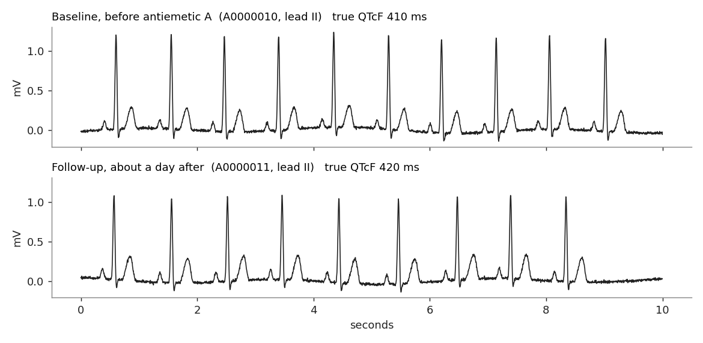

# **Tutorial: from ECG files to an effect estimate**

This hands-on tutorial takes one research question all the way from raw waveform files to an effect estimate, using the OMOP CDM Waveform Extension as the bridge. Everything runs on a small synthetic dataset that lives in this repository, so you can work through it on a laptop with no data-use agreement.

<br>

## **The research question**

> Among hospitalized adults who start one of two antiemetics, does **antiemetic A** (a QT-prolonging drug) lengthen the **QTc interval** compared with **antiemetic B** (a comparator with no QT effect)?

The QTc is not stored anywhere in the EHR. It has to be *measured from the ECG waveform*. That makes the question a good test of the whole chain: files, extension tables, derived features, cohort definition, and causal analysis.

<br>

## **Overview**

| Session | Focus | Learning outcome |
|---|---|---|
| [1. Explore WFDB recordings](tutorial-exercise-1.html) | What a waveform file does and does not tell you | Read a WFDB header and signal, convert digital samples to millivolts, and list what must come from outside the file |
| [2. Transform to the Waveform Extension](tutorial-exercise-2.html) | ETL into `waveform_occurrence`, `waveform_registry` and `waveform_channel_metadata` | Build the three tables from headers plus an export manifest, then validate them |
| [3. Derive features](tutorial-exercise-3.html) | From signal to `waveform_feature` and `MEASUREMENT` | Extract heart rate and QTc, store them with provenance, and check them against the answer key |
| [4. Effect estimation](tutorial-exercise-4.html) | From features to a causal estimate | Define a new-user cohort in SQL, compare crude and adjusted estimates, use negative controls, and quantify what measurement choices do to the answer |

Each session builds on the previous one, but each also ships its own reference output, so you can start at any session.

<br>

## **Prerequisites**

- Python 3.9 or newer (the main track), or R 4.x with no extra packages (the R track of Exercise 4)
- Basic SQL; familiarity with the OMOP CDM (`PERSON`, `VISIT_OCCURRENCE`, `DRUG_EXPOSURE`, `MEASUREMENT`) is helpful
- Git, or the ability to download a folder from GitHub

No signal-processing background is assumed. Sessions 1 and 3 explain the few ECG terms you need (R peak, RR interval, QT, QTc).

### Setup

```sh
git clone https://github.com/OHDSI/WaveformWG.git
cd WaveformWG/syntheticData/qtc
python3 -m venv .venv && source .venv/bin/activate       # Windows: .venv\Scripts\activate
pip install -r requirements.txt
python3 tutorial/solutions/ex2_waveform_etl.py           # should print PASS for every check
```

The dataset is already built and committed, so you do not need to run the generator. To rebuild it from scratch (about a minute, deterministic), run `./build.sh`.

<br>

## **Demo dataset**

300 synthetic inpatients, 542 ten-second three-lead ECGs in real WFDB format (a baseline ECG before the first dose and, for most patients, a follow-up ECG a day or so later), the OMOP tables they link to, and the Waveform Extension tables. Details, table by table, are on the [dataset description](tutorial-data-description.html) page.



<br>

## **Exercises**

1. [Exercise 1: Explore WFDB recordings](tutorial-exercise-1.html) - Open a record, check units and timing, and find out what the file cannot tell you.
2. [Exercise 2: Transform to the Waveform Extension](tutorial-exercise-2.html) - Build and validate `waveform_occurrence`, `waveform_registry` and `waveform_channel_metadata`.
3. [Exercise 3: Derive features](tutorial-exercise-3.html) - Extract ECG intervals, write `waveform_feature` and `MEASUREMENT`, and compare with the answer key.
4. [Exercise 4: Effect estimation](tutorial-exercise-4.html) - Define the cohort, estimate the effect of drug A on QTc, and critique the result.

Every exercise page follows the same pattern: a goal, the steps with code, questions, a collapsed answer for each question, a deliverable, and a short checklist. Try the question before you open the answer.

<br>

## **About these materials**

**Don't quote the effects.** The simulated drug effects are deliberately exaggerated and the "drugs" are not real products. They are a teaching device, not evidence about any medication.

**The answer key is the point.** Because the data are simulated, the true QT intervals and the true treatment effect are known. Each exercise ends by comparing what you computed with the truth, which is something real data never allow.

**The detector is a toy.** The ECG interval detector is short and readable on purpose. It is not a validated clinical algorithm.

**Placeholder concepts.** Vocabulary for derived ECG measurements, algorithms and some units does not exist yet. The dataset uses clearly labeled placeholder concept ids in the 2082599xxx range ([`concept.csv`](https://github.com/OHDSI/WaveformWG/blob/main/syntheticData/qtc/data/omop/concept.csv)); the WAVEFORM vocabulary delta ids (2082499xxx) are reused where they exist.

## **Getting Help**

If you get stuck, see [Get Started](get-started.html), open an issue on [GitHub](https://github.com/OHDSI/WaveformWG/issues), or ask in the Waveform Working Group Teams channel. We also discuss the tutorial at the [weekly meetings](project-management.html#meeting-schedule).

<br>
